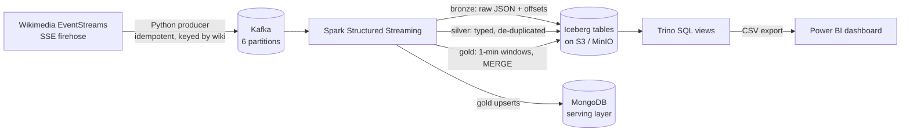

# Real-Time Wikipedia Streaming Lakehouse

A real-time data platform that streams every edit made across Wikipedia and its sister sites (roughly 20–60 events per second, around the clock) through **Kafka** and **Spark Structured Streaming** into an **Apache Iceberg** lakehouse on **S3**. It serves live per-minute metrics from **MongoDB**, exposes analytics views through **Trino**, and feeds a **Power BI** dashboard.



## What it demonstrates

| Concept | Where |
|---|---|
| Consuming a live Server-Sent Events stream with automatic reconnect and resume (`Last-Event-ID`) | `producer/producer.py` |
| Kafka producer tuning: idempotence, `acks=all`, lz4 compression, batching, back-pressure on a full queue | `producer/producer.py` |
| Kafka in KRaft mode (no ZooKeeper), a 6-partition topic keyed by wiki | `docker-compose.yml` |
| Spark Structured Streaming with event-time **watermarks**, **de-duplication**, and **1-minute tumbling windows** | `streaming/transforms.py` |
| **Medallion architecture** (bronze → silver → gold) in **Apache Iceberg**, partitioned by day | `streaming/stream_job.py` |
| Exactly-once-style gold writes: Iceberg `MERGE INTO` + MongoDB upserts make micro-batch replays safe | `stream_job.py`, `mongo_sink.py` |
| Object storage on **AWS S3** (MinIO locally), with a least-privilege IAM policy, encryption, and a lifecycle policy | `aws/` |
| Federated SQL over the lakehouse with **Trino** | `trino/`, `sql/trino_views.sql` |
| **Power BI** dashboard with DAX measures | `powerbi/` |
| 9 pytest tests, including a full end-to-end run of the streaming job with duplicate and late-arriving events | `tests/` |

## Run it locally

Needs Docker Desktop (8 GB of memory allocated is comfortable).

```bash
cp .env.example .env
docker compose up -d --build        # first build downloads Spark/Kafka/Iceberg jars (~5 min)
docker compose logs -f producer     # watch events flow in
```

| UI | URL |
|---|---|
| MinIO console (see Iceberg files in S3) | http://localhost:9001 (admin / password123) |
| Trino | http://localhost:8080 |

After a few minutes, query the lakehouse:

```bash
docker compose exec -T trino trino < sql/trino_views.sql     # create analytics views (once)
docker compose exec trino trino --execute "
  SELECT wiki, sum(edits) edits, round(100.0*sum(bot_edits)/sum(edits),1) bot_pct
  FROM iceberg.wiki.edits_per_minute GROUP BY wiki ORDER BY edits DESC LIMIT 10"
```

And the MongoDB serving layer:

```bash
docker compose exec mongodb mongosh wiki --eval '
  db.edits_per_minute.find({}, {_id:0}).sort({window_start:-1}).limit(5)'
```

Then build the dashboard: see [`powerbi/POWERBI.md`](powerbi/POWERBI.md).

## Deploying storage to AWS S3

The same stack writes to real S3 by changing only environment variables.

```bash
aws configure                                        # admin credentials, one time
./aws/setup_s3.sh my-wiki-lakehouse-<yourname> us-east-1
```

That creates a private, encrypted bucket with a lifecycle rule and an IAM user limited to that bucket. Put the printed keys in `.env`:

```bash
AWS_ACCESS_KEY_ID=...
AWS_SECRET_ACCESS_KEY=...
AWS_REGION=us-east-1
S3_ENDPOINT=https://s3.us-east-1.amazonaws.com
WAREHOUSE=s3://my-wiki-lakehouse-<yourname>/warehouse
```

Then `docker compose up -d --force-recreate iceberg-rest spark-stream trino`. Data volume is small (well under 1 GB/day), which stays within the AWS free tier's 5 GB of S3.

## Local development (no Docker)

```bash
python -m venv .venv && source .venv/bin/activate
pip install -r requirements.txt          # needs Java 17+ for Spark
python -m pytest -q

# Run the streaming job against JSON files instead of Kafka/Iceberg:
python -m streaming.stream_job --source files --sink parquet --once \
  --input-path data/input --output-path data/output
```

## Data model

| Layer | Table | Grain | Notes |
|---|---|---|---|
| Bronze | `wiki.events_raw` | Kafka message | Raw JSON + topic/partition/offset. Can be replayed to rebuild everything else |
| Silver | `wiki.edits` | One edit | Typed columns, `bytes_delta`, de-duplicated on `event_id`, partitioned by `days(event_ts)` |
| Gold | `wiki.edits_per_minute` | Wiki × minute | Edits, bot/human split, new pages, bytes changed, active editors |
| Serving | MongoDB `wiki.edits_per_minute` | Wiki × minute | Unique index on `(wiki, window_start)` for fast "last N minutes" reads |

## Design decisions

- **Why a 3-minute watermark?** Events can arrive late from network hiccups or producer reconnects. The watermark tells Spark how long to wait before finalizing a minute: long enough to catch stragglers, short enough to keep state small and results fresh. Events later than that are still kept in bronze, so nothing is lost.
- **Why de-duplicate?** When the producer reconnects it resumes from the last event ID, so a few events can be delivered twice. `dropDuplicatesWithinWatermark` removes them without keeping unbounded state.
- **Why MERGE and upserts instead of append for gold?** If Spark retries a micro-batch after a failure, a plain append would double-count that minute. Merging on `(wiki, window_start)` makes retries harmless.
- **Why Iceberg?** It gives ACID tables on plain object storage, so Spark writes while Trino reads concurrently, with schema evolution and time travel. Both Spark and Trino use the same REST catalog.
- **Why both Iceberg and MongoDB?** Iceberg is the system of record for analytics over history. MongoDB answers "what's happening right now" in milliseconds for an app or API.
- **Why key Kafka messages by wiki?** It keeps each wiki's events in order within a partition and spreads load across 6 partitions, so Spark can read them in parallel.
